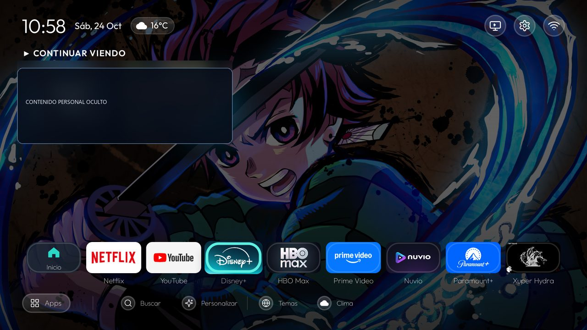
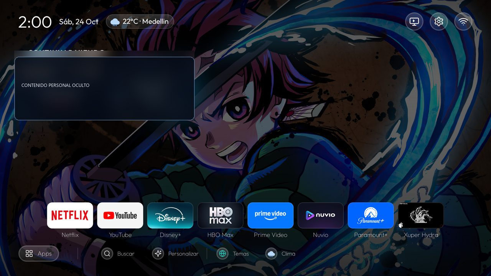

# HarolHome TV

Una pantalla de inicio personalizada y pensada para control remoto en Android TV y Google TV: aplicaciones favoritas, Continuar viendo, temas, clima por ubicación, fondos y resaltado de foco.

- [English](README.md) · [Compilar e instalar](docs/INSTALLATION.md) · [Adaptar otra marca de TV](docs/TV_BRAND_ADAPTATION.md) · [Capturas Caixun](docs/SCREENSHOTS.md) · [Contribuir](CONTRIBUTING.md) · [Avisos](NOTICE.md)

## Origen del proyecto

HarolHome TV es una continuación personalizada y con nuevo nombre del proyecto público **Tv-Personalize**, creado por Harol Ardila: [github.com/harolito1995/Tv-Personalize](https://github.com/harolito1995/Tv-Personalize). Este repositorio conserva ese historial y reconoce el trabajo heredado. El nombre nuevo identifica esta versión personalizada; no afirma que el código se haya escrito desde cero ni oculta el proyecto público anterior.

El paquete Java y sus carpetas usan `com.harolhome.tv`. El ID Android permanece como `com.gathin.tvhome` para actualizar la instalación existente del Caixun sin desinstalar ni perder datos; es un identificador de compatibilidad, no el nombre del producto.

## Capturas del televisor Caixun

Capturas reales del Caixun 4K con Android TV 14: la base visual de C1.3 Plan 4 y la pantalla actual de HarolHome TV. En las copias públicas se ocultaron las imágenes y títulos personales de Continuar viendo. Consulta [las notas de las capturas](docs/SCREENSHOTS.md).

| Antes: base C1.3 Plan 4 | Después: HarolHome TV |
| --- | --- |
|  |  |

## Funciones

- Dock y cuadrícula de aplicaciones para control remoto, configurables por televisor.
- Elementos de Continuar viendo cuando la aplicación publica datos compatibles con Android TV Watch Next.
- Cuatro temas, foco visible, búsqueda, filtros y vistas previas de temas y fondos.
- Accesos a entradas, Wi-Fi y ajustes cuando el televisor ofrece actividades compatibles.
- Pausa sesiones multimedia al volver a Home; se pueden excluir aplicaciones de música. Requiere acceso de listener de notificaciones para identificar sesiones.
- Clima de una ubicación reciente de Android, por IP como respaldo o de una ciudad seleccionada manualmente; pronóstico Open-Meteo con caché.

Validado físicamente en un Caixun 4K con Android TV 14. El televisor entrega 3840×2160 a 60 Hz, pero informa a las aplicaciones un área lógica de 1920×1080 y densidad 320. HarolHome no cambia modos de pantalla ni amplía videos, y no garantiza igual salida en otros televisores. La calidad de video se selecciona en cada aplicación y depende de esta, el contenido, la suscripción, la red y la pantalla.

## Compilar

Requisitos: JDK 17 y Android SDK platform 34. El wrapper de Gradle fija las versiones del build.

```powershell
cd launcher
.\gradlew.bat :app:assembleDebug
```

En macOS/Linux: `./gradlew :app:assembleDebug`. El APK queda en `launcher/app/build/outputs/apk/debug/app-debug.apk`. Los APK generados, respaldos y datos crudos del televisor no se publican. Se incluyen únicamente las dos capturas Caixun seleccionadas y anonimizadas para documentar el proyecto.

## Instalar y adaptar

Sigue [la guía de instalación](docs/INSTALLATION.md) y [la guía para otra marca](docs/TV_BRAND_ADAPTATION.md). Las actualizaciones usan `adb install -r` y conservan los datos. El proceso no borra datos ni desactiva el launcher de fábrica. Los paquetes de aplicaciones y ajustes por televisor están en `launcher/app/src/main/res/values/config.xml`.

Solo se ha probado físicamente la configuración Caixun anterior. Las contribuciones para otras marcas deben indicar modelo y versión exactos, cambios y pruebas, quitando datos privados de red.

## Privacidad

No hay cuentas ni analítica. El clima puede enviar coordenadas a Open-Meteo o consultar ubicación aproximada por IP con ipapi.co si no hay una ubicación reciente. Los fondos pueden conectarse al proveedor configurado. El listener multimedia consulta sesiones activas para pausarlas al volver a Home; no lee el texto de notificaciones. Consulta [NOTICE.md](NOTICE.md).

## Licencia

MIT; consulta [LICENSE](LICENSE). La fuente Outfit incluida tiene su aviso SIL Open Font License en [launcher/FONT-LICENSE-OFL.txt](launcher/FONT-LICENSE-OFL.txt).
