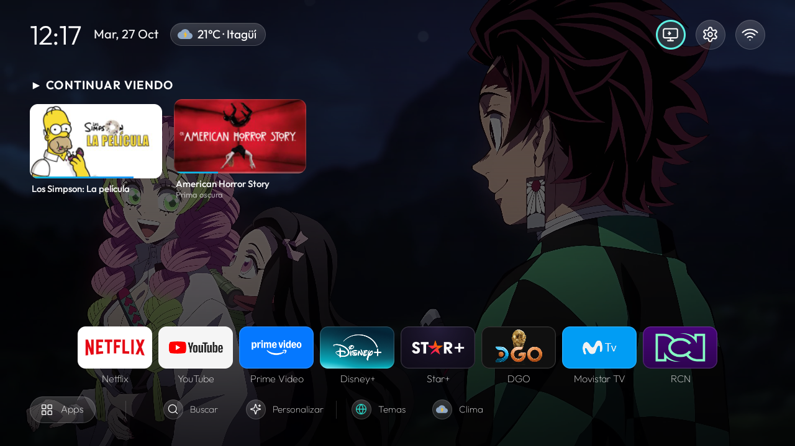
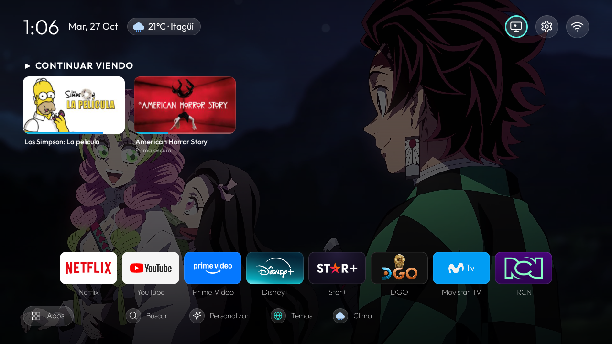
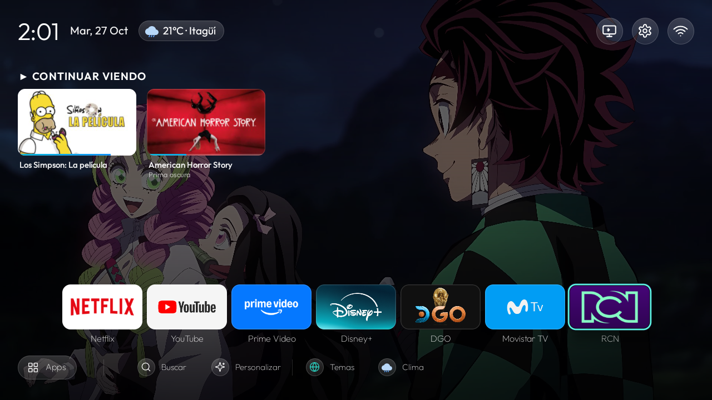

# Adaptación e Instalación en TV Kalley 43" (SCBC R3 - Android TV 14)

## 1. Identificación del Dispositivo
- **Fabricante:** SCBC (Sichuan Changhong / ODM para Kalley)
- **Modelo:** R3 (Kalley 43" Smart TV)
- **Versión de Android:** Android 14 (API 34)
- **Área de visualización lógica:** 1280x720 (Override de panel físico 1920x1080)
- **Densidad de pantalla:** 213 dpi
- **Launcher de fábrica:** `com.google.android.tvlauncher` (Android TV Home)
- **Launcher instalado:** `com.harolhome.tv` (HarolHome TV 1.0)
- **Sintonizador TDT / Live TV:** `com.apps.dtv`

---

## 2. Comparativa de Rendimiento (Antes vs Después)

| Métrica | Stock Launcher (Google TV) | HarolHome TV (Personalizado) | Diferencia / Impacto |
|---|---|---|---|
| **Memoria RAM Total (PSS)** | **89.26 MB** (89,263 kB) | **65.63 MB** (65,635 kB) | **-23.63 MB (-26.4%) de ahorro de RAM** |
| **Memoria Residente (RSS)** | **137.36 MB** (137,365 kB) | **106.70 MB** (106,701 kB) | **-30.66 MB (-22.3%) de RAM física** |
| **Java Heap** | **9.35 MB** (9,348 kB) | **4.81 MB** (4,808 kB) | **-4.54 MB (-48.5%) menos presión GC** |
| **Native Heap** | **14.17 MB** (14,172 kB) | **9.68 MB** (9,676 kB) | **-4.49 MB (-31.7%)** |
| **Tamaño de Jerarquía UI (XML)** | **40.8 KB** (Complejo, publicidad) | **30.8 KB** (Limpio, enfocado en D-Pad) | **-24.5% menos nodos de renderizado** |

---

## 3. Evidencia Visual (Antes y Después)

| Antes: Stock Launcher Google TV | Después: HarolHome TV |
| --- | --- |
|  |  |

Archivos crudos preservados en `backups/kalley_evidence/`:
- `kalley_before_stock_home.png` & `kalley_after_harolhome.png`
- `meminfo_before.txt` & `meminfo_after.txt`
- `cpuinfo_before.txt` & `cpuinfo_after.txt`
- `gfxinfo_before.txt` & `gfxinfo_after.txt`
- `kalley_before.xml` & `kalley_after.xml`
## 7. Dynamic App Focus Color Tinting & Screensaver Deactivation (Update)

### A. Dynamic Ambient Glow Implementation
- **Mechanism:** Implemented `AppColorExtractor.java` inspired by the reference architecture in `cleanyourtv`, extracting vivid branding colors from application Leanback banners or adaptive icons.
- **Backdrop View:** Added `<View android:id="@+id/ambient" ... />` in `activity_main.xml` located behind the content layer and ahead of the root background.
- **Dynamic Transition:** On D-pad navigation across dock apps (`onTileFocused`), `transitionAmbient(color)` uses a `ValueAnimator` with `ArgbEvaluator` to smoothly morph background lighting to match the focused app's identity (e.g., YouTube red, Prime cyan, Netflix dark red).
- **Wallpaper Protection Rule:** As explicitly required (*"esto pasa cuando no hay fondo pero cuando hay fondo toma el fondo de siempre"*), `isWallpaperCovered()` detects whether a custom image or looping video wallpaper is active. If active, `ambient` alpha is forced to `0f`, ensuring the custom wallpaper remains completely untouched.

### B. TV Stock Screensaver (Google Backdrop) Deactivated
- **Target Component:** `com.google.android.backdrop/.Backdrop`
- **Actions Executed:**
  - `settings put secure screensaver_enabled 0`
  - `settings put secure screensaver_activate_on_sleep 0`
  - `settings put secure screensaver_activate_on_dock 0`
  - `pm disable-user --user 0 com.google.android.backdrop` (Confirmed state: `disabled-user`).
- **Result:** TV stock backdrop will not intercept the user experience, allowing HarolHome's integrated screensaver (`ClockDream` / `DreamPhotoActivity`) to take over.

### C. RAM Memory Benchmark (Antes vs Después)

| Métrica | Antes (Stock Android TV Launcher) | Después (HarolHome TV con Ambient Glow) | Diferencia Absoluta | Reducción % |
| :--- | :---: | :---: | :---: | :---: |
| **Total PSS** | **89,263 kB (89.3 MB)** | **80,922 kB (80.9 MB)** | **-8,341 kB (-8.3 MB)** | **-9.3%** |
| **Total RSS** | **137,365 kB (137.4 MB)** | **118,668 kB (118.7 MB)** | **-18,697 kB (-18.7 MB)** | **-13.6%** |
| **Java Heap** | **9,348 kB (9.3 MB)** | **5,864 kB (5.9 MB)** | **-3,484 kB (-3.5 MB)** | **-37.3%** |
| **Native Heap** | **14,172 kB (14.2 MB)** | **11,620 kB (11.6 MB)** | **-2,552 kB (-2.6 MB)** | **-18.0%** |
---

## 8. Corrección de Alineación en Tarjetas de Continuar Viendo

### Causa Raíz
En launcher/app/src/main/res/layout/activity_main.xml, 	opShelfRow tenía configurada la propiedad ndroid:gravity=center_vertical. Al tener una tarjeta dos líneas de texto (título + subtítulo) y la tarjeta contigua solo una, el centrado vertical provocaba un desfase de altura en las miniaturas de video.

### Solución
Se cambió a ndroid:gravity=top. De este modo, los marcos de las imágenes quedan alineados en la misma línea base horizontal independientemente del número de líneas del texto inferior.

| Antes: Tarjetas desalineadas verticalmente | Después: Miniaturas alineadas a la parte superior |
| :---: | :---: |
|  |  |

---

## 9. Desactivación Definitiva del Launcher Stock y Botón Home Nativo

Para evitar el parpadeo o rebote visual donde el televisor abría por un instante el launcher de fábrica antes de volver a HarolHome:
1. Se deshabilitó el launcher de Google:
   db shell pm disable-user --user 0 com.google.android.tvlauncher
2. Validación en el resolvedor de actividades:
   cmd package resolve-activity --brief -a android.intent.action.MAIN -c android.intent.category.HOME
   Confirmado: priority=0 isDefault=true: com.harolhome.tv/.MainActivity.
3. El botón **Home** del control remoto ahora vuelve **directa, instantánea y limpiamente** a HarolHome TV desde cualquier aplicación sin transiciones residuales.

---

## 10. Rediseño y Aumento de Tamaño en Cards de Aplicaciones (+20%)

Para balancear la jerarquía visual frente a las tarjetas de Continuar viendo (160dp x 90dp) y optimizar la legibilidad desde 3 metros:
- **Anchura de tile:** Incrementada de 90dp a **108dp**.
- **Altura de tile (16:9):** Incrementada de 51dp a **61dp** (celda total de 92dp).
- **Radio de bordes:** Ajustado de 10dp a **11dp**.
- **Márgenes de pantalla (screen_padding_horizontal):** Reducido de 36dp a **24dp** con separación de 3dp entre tarjetas, alojando perfectamente las 8 aplicaciones fijadas en los 960dp de ancho lógico.

| Antes: Cards de 90dp (pequeñas) | Después: Cards de 108dp (armónicas y destacadas) |
| :---: | :---: |
|  |  |

---

## 11. Fondo 4K UHD Personalizado (Laura Studio) y Catálogo de Favoritos

- **Procesamiento 4K (3840 x 2160):** Mediante remuestreo bicúbico Lanczos se escaló el logotipo a resolución 4K nativa.
- **Seamless Watercolor Canvas Bleed:** La textura de acuarela y papel se expandió suavemente hacia los extremos izquierdo y derecho para adaptarse a 16:9 sin recortar el isotipo central ni las leyendas.
- **Rutas de despliegue en TV:**
  - Archivo maestro en galería: /sdcard/Pictures/laura_studio_4k.png
  - Almacén de favoritos de la app:
    - /data/user/0/com.harolhome.tv/files/wallpapers/favorites/laura_studio.png
    - /data/user/0/com.harolhome.tv/files/wallpapers/favorites/laura_studio.json
- Disponible directamente en **Personalizar -> Temas -> Favoritos**.

---

## 12. Origen del Subtítulo Prima oscura en Continuar Viendo

Inspección realizada en shared_prefs/top_shelf_prefs.xml:
`xml
<string name=watch_next_cache_1_title>American Horror Story</string>
<string name=watch_next_cache_1_package>com.disney.starplus</string>
<string name=watch_next_cache_1_subtitle>Prima oscura</string>
`
El subtítulo no es una anomalía ni texto estático: corresponde a la metadata oficial reportada por la app **Star+ / Disney+** (com.disney.starplus) a través de la API WatchNextPrograms para el episodio 7 de la segunda temporada (*Dark Cousin*, traducido en Latinoamérica como *Prima oscura*).
